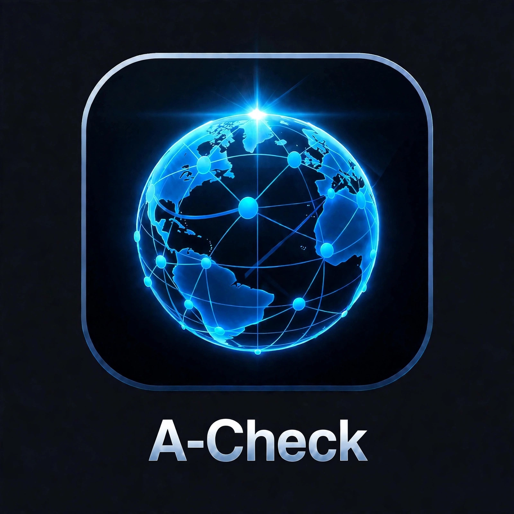
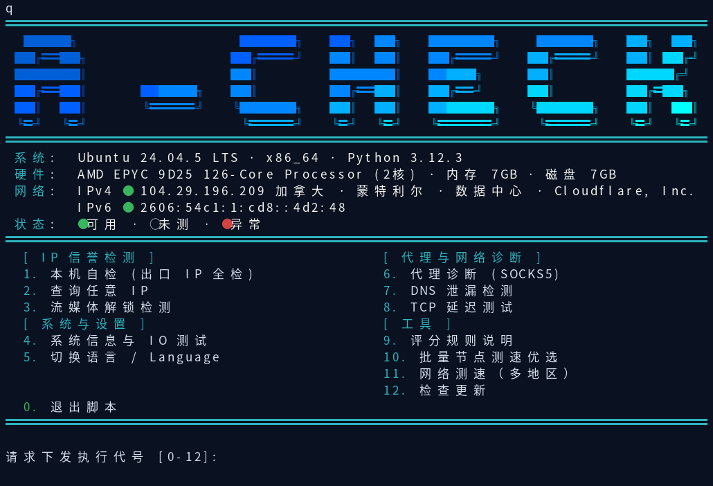
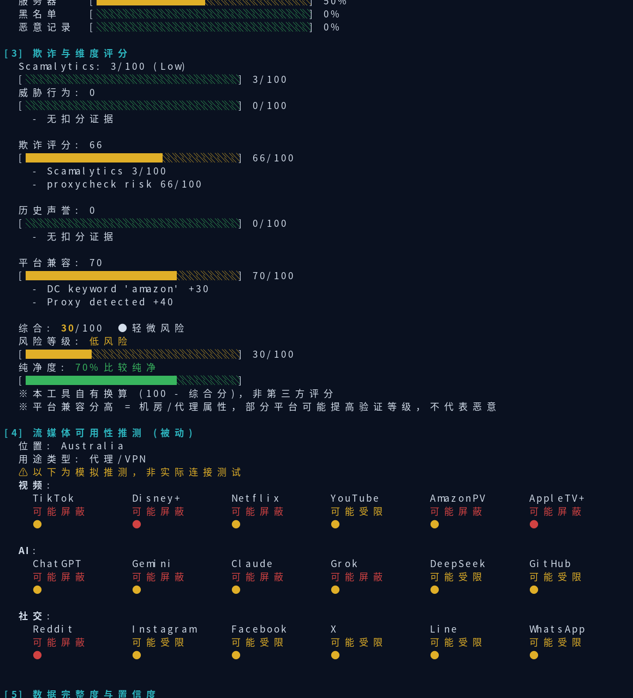
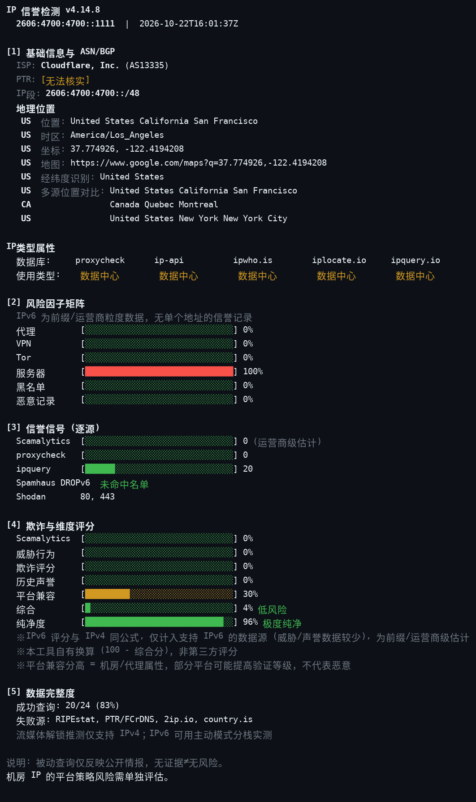
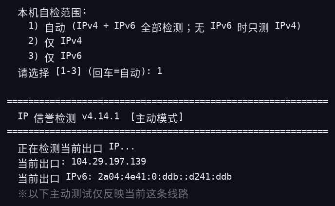
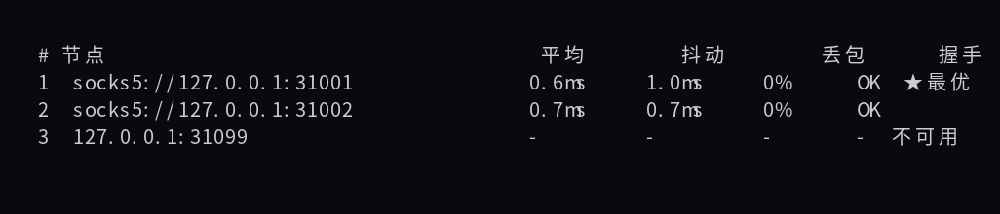

<div align="center">
  
  <h1>A-Check</h1>
  <p><b>IP 純淨度與網路品質檢測工具</b> — 多源聚合 · 雙模式 · 零依賴單檔案</p>
  <p>
    
    
    
    
  </p>
  <p>
    <a href="README.md">English</a> ·
    <a href="README.zh.md">简体中文</a> ·
    <a href="README.zh-TW.md">繁體中文</a> ·
    <a href="README.ja.md">日本語</a> ·
    <a href="README.ru.md">Русский</a> ·
    <a href="README.fa.md">فارسی</a>
  </p>
</div>

---

## 介面預覽

主選單（橫幅即時顯示系統 / 硬體 / 網路狀態，12 項功能四組排布）：



IP 檢測報告（以公共 DNS 8.8.8.8 為例）：



IPv6 報告（前綴粒度：地理 / ASN / 類型 / 逐源信譽信號，不合成總分）：



本機自檢範圍選擇（自動雙棧 / 僅 IPv4 / 僅 IPv6）：



批次節點測速優選：



## 這是什麼

A-Check 是一個單檔案 Python 腳本（`acheck.py`，僅標準庫、零外部依賴），用於評估一個 IP 位址的**信譽與純淨度**，並檢測本機網路的**出口品質**。它向 33 個公開資料來源查詢並交叉核對，彙總為一份報告。所有評分均為多源聚合，單一來源不決定結論。

## 雙模式

| 模式 | 用途 | 行為 |
|---|---|---|
| **本機自檢（主動）** | 檢查你目前的出口 IP 與本機網路 | 檢測出口 IP 全量信譽、本機系統/硬體、串流實測解鎖、DNS 洩漏與推薦、25 連接埠連通、多地區測速 |
| **查詢任意 IP（被動）** | 買 VPS / 租代理前先查對方 IP 乾不乾淨 | 只呼叫公開情報介面，**不向目標 IP 發送任何封包** |

## 報告結構

一份完整報告按編號章節輸出：

- **[1] 基礎資訊** — 歸屬地、ISP / 組織、AS 號；**IP 類型屬性**（機房 / 住宅 / 行動 / 代理 / VPN / Tor 等多源標記）；**地理位置組**（國家碼徽章打頭：位置、多源位置對比、經緯度反查識別、時區、座標、地圖連結）；主動模式附本機系統資訊
- **[2] 風險因子** — 代理 / VPN / Tor / 伺服器 / 黑名單 / 惡意紀錄 六個因子逐個給出「命中源占比」進度條，一眼看清哪些來源把該 IP 判為風險
- **[3] 欺詐與維度評分** — 欺詐評分、威脅行為、歷史信譽、平台相容、綜合評分逐項成條，末行給出**純淨度**與風險等級（分數越低越乾淨）
- **[4] 串流與平台可用性** — 本機自檢為**實測**解鎖結果；查任意 IP 時為基於信譽訊號的**推測**（明確標註信心度）
- **[5] DNS 伺服器推薦** — 按 IP 歸屬地推薦就近 DNS（被動模式）
- **[6] 資料完整度與信心度** — 本次實際拿到多少來源的資料、核心來源是否齊全，據此給出信心度，資料不足時會在報告中如實標註

主動模式另有無編號章節：DNS 洩漏與推薦、25 連接埠連通性、多地區測速表，報告共 8 個章節段落。

## 主選單 12 項功能

| # | 功能 | 說明 |
|---|---|---|
| 1 | 本機自檢 (出口 IP 全檢) | 主動模式全量檢測，結尾附多地區測速 |
| 2 | 查詢任意 IP | 輸入公網 IPv4 或 IPv6 出被動報告，查完自動返回主選單 |
| 3 | 串流解鎖檢測 | 單獨實測 18 個平台的解鎖狀態 |
| 4 | 系統資訊與 IO 測試 | 系統 / CPU / 記憶體 / 磁碟資訊與磁碟讀寫測速 |
| 5 | 切換語言 / Language | 简体中文 / 繁體中文 / English / 日本語 / Русский / فارسی |
| 6 | 檢查更新 | 對比 GitHub 最新 Release 提示新版本 |
| 7 | 代理診斷 (SOCKS5) | 六步：握手 → 代理出口 IP → 出口信譽 → DNS 洩漏 → TCP 延遲 → 經代理吞吐（5 個地區樞紐取最快） |
| 8 | DNS 洩漏檢測 | 對比系統解析器與直連解析結果，判斷 DNS 是否走漏 |
| 9 | TCP 延遲測試 | 對任意 host:port 測延遲 / 抖動 / 丟包（min / avg / max） |
| 10 | 評分規則說明 | 評分維度、扣分項與等級劃分的完整說明 |
| 11 | 批次節點測速優選 | 貼上多個 host:port 或 SOCKS5 代理，並發測延遲與可用性，排名輸出、最優標綠，並對最優代理實測下載吞吐 |
| 12 | 網路測速（多地區） | 28 個地區節點下載測速表（多連接峰值口徑），附本機上下行 |

串流實測覆蓋 18 個平台：AI（ChatGPT / Gemini / Claude / Grok / DeepSeek）、影片（TikTok / Disney+ / Netflix / YouTube / Amazon Prime Video / Apple TV+）、社交及其他（Facebook / Instagram / Reddit / X / WhatsApp / Line / GitHub），區分原生解鎖與 DNS 解鎖（Smart DNS）。

## 快速開始

從 [Releases](https://github.com/alariclin/A-Check/releases) 下載對應系統的壓縮包，解壓後執行啟動器：

- **macOS**：雙擊 `run.command`（或終端 `bash run.command`）；也可下載 mac-app 包，解壓後雙擊 `A-Check.app`
- **Windows**：雙擊 `run.bat`
- **Linux / VPS**：`bash run.sh`

**一鍵運行**（複製貼上即可，自動下載目前發行包並啟動）：

macOS：
```
curl -sL https://github.com/alariclin/A-Check/releases/download/v4.14.3/A-Check-v4.14.3-mac-app.zip -o acheck-app.zip && unzip -qo acheck-app.zip && open A-Check.app
```

Linux / VPS：
```
curl -sL https://github.com/alariclin/A-Check/releases/download/v4.14.3/A-Check-v4.14.3-linux.zip -o acheck.zip && unzip -qo acheck.zip && cd acheck-linux && bash run.sh
```

Windows（PowerShell）：
```
Invoke-WebRequest https://github.com/alariclin/A-Check/releases/download/v4.14.3/A-Check-v4.14.3-windows.zip -OutFile acheck.zip; Expand-Archive acheck.zip -Force; cd acheck-win; .\run.bat
```

任意系統（單一檔案，需 Python 3.8+）：
```
curl -sL https://raw.githubusercontent.com/alariclin/A-Check/main/acheck.py -o acheck.py && python3 acheck.py
```

**CDN 鏡像——GitHub 直連困難的地區（如中國大陸）可用。單文件版，功能完整：**
gh-proxy（大陸直連）：
```
curl -sL https://gh-proxy.com/https://raw.githubusercontent.com/alariclin/A-Check/main/acheck.py -o acheck.py && python3 acheck.py
```
jsDelivr：
```
curl -sL https://cdn.jsdelivr.net/gh/alariclin/A-Check@main/acheck.py -o acheck.py && python3 acheck.py
```
也可以直接執行腳本本體（需 Python 3.8+）：

```
python3 acheck.py            # 進入互動選單
python3 acheck.py 8.8.8.8    # 直接查一個 IP
```

## 命令列用法

```
python3 acheck.py [IP] [選項]
```

| 選項 | 說明 |
|---|---|
| `IPv4` | 被動查詢指定公網 IP |
| `--active` | 主動模式：本機出口全量自檢 |
| `--ipv4-only` | 配合 `--active`：只測 IPv4（跳過 IPv6） |
| `--ipv6-only` | 配合 `--active`：只測 IPv6 |
| `--proxy HOST:PORT` | 代理診斷（可配 `--proxy-user` / `--proxy-pass`） |
| `--batch 列表` | 批次節點測速優選（逗號分隔 host:port 或 socks5:// 代理） |
| `--speed` | 多地區測速表 |
| `--explain` | 輸出評分規則說明 |
| `--json` | 以 JSON 輸出（可與 IP / --active / --proxy 組合） |
| `--zh / --zh-tw / --en / --ja / --ru / --fa` | 指定輸出語言 |

## 資料來源

多源聚合、逐源署名，主要包括：

- **地理與歸屬**：ip-api.com、ipwho.is、ipwhois.app、ipinfo.io、FreeIPAPI、ipapi.is、ip.guide、GeoJS、DB-IP、RIPEstat、iplocate.io、ipquery.io、ipapi.co、2ip.io、HackerTarget、country.is、RDAP、PTR/FCrDNS 反查
- **信譽與欺詐**：Scamalytics、proxycheck.io、Shodan InternetDB、GreyNoise、SANS ISC、StopForumSpam、urlscan.io、AlienVault OTX、blocklist.de
- **威脅與名單**：Spamhaus DROP、Feodo Tracker、Emerging Threats、Tor 出口節點名單、IPsum、X4BNet VPN ranges

每個因子與分數都由多源投票得出；單一來源的誤報不會直接決定結論。

## 注意事項

- 被動查詢支援公網 IPv4 與 IPv6；內網 / 保留位址會被拒絕並說明原因。IPv6 為前綴/營運商粒度報告（地理/ASN/類型/名單與逐源信譽信號，不合成總分）。本機自檢為雙棧：偵測到 IPv6 出口時與 IPv4 一併檢測，兩出口不在同一網路時給出洩漏警告
- 推測模式（查任意 IP 的串流可用性）基於信譽訊號推斷，與實測可能有出入，請以報告標註的信心度為準
- 測速為多連接峰值口徑，反映鏈路峰值能力，不等同於單連接持續速度
- 終端寬度建議 ≥ 60 列；純文字環境（管道 / 無顏色）會自動降級為無色輸出
- 本工具僅用於自查與維運評估，請遵守各資料來源服務條款

## 首次打開被系統攔截時

- **macOS**：A-Check.app 未做蘋果開發者簽名，首次打開可能提示「來自身分不明的開發者」無法打開。右鍵點擊 `A-Check.app`（或 `run.command`）→「打開」→ 在彈窗裡再點一次「打開」即可，只需操作一次；也可以到「系統設定 → 隱私權與安全性」裡點「仍要打開」
- **Windows**：首次執行 `run.bat` 可能彈出 SmartScreen 提示，點「更多資訊」→「仍要執行」

## 授權

MIT License
